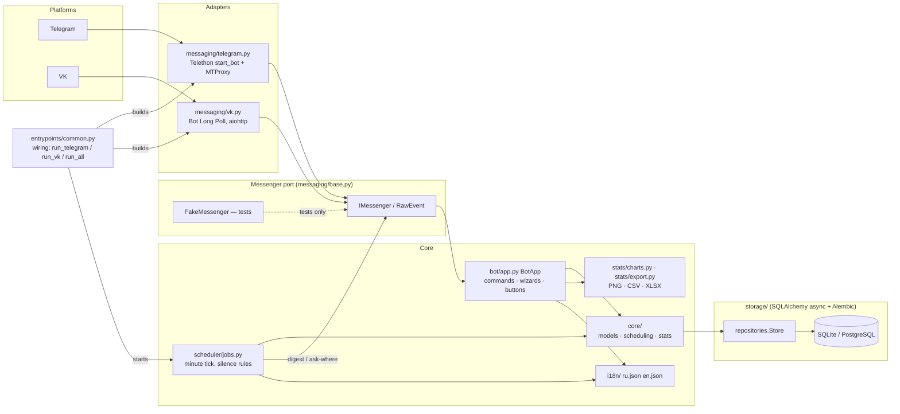

# taskshed — task reminder bot with location awareness

**Language:** [English](README.md) · [Русский](README.ru.md)

A chat bot that reminds you of your tasks **depending on where you are right
now**: home routines at home, work tasks at work. Works on **Telegram**
(Telethon, MTProto proxy support) and **VK** (Bot Long Poll) through a single
platform-independent core.

> The bot never tracks your GPS location — you tell it where you are with one
> tap ("Home" / "Work" / ...). Reminders are silent when nothing is due.

## Features

- Tasks split by **places** you define yourself (`/places`).
- Schedules: one-off with deadline, every N days, specific weekdays,
  day of month; every repeat is a materialized **occurrence** you can mark
  ✅ done, ⏭ postpone (15 min/1 h/4 h/1 day) or ⏭ skip right from the
  reminder message.
- Per-user **reminder settings**: fixed times or interval mode, quiet hours,
  time zone, how long your chosen location stays valid.
- **No noise**: if you have no tasks today, or none match your current place,
  the bot says nothing. Stale location → it just asks "Where are you now?".
- **Statistics**: text summary, CSV/XLSX export, PNG charts (GitHub-style
  activity heatmap with missed/planned/skipped markers, top tasks/places,
  completion trend) — for any period or
  the whole history.
- **Multi-account**: link your Telegram and VK identities with a one-time
  code (`/link`); data and reminders are shared.
- Chat interfaces in **Russian and English** (`/lang`).
- Persistent storage: SQLite by default, PostgreSQL-ready (SQLAlchemy 2,
  Alembic migrations).

## Quick start

```bash
python -m venv .venv && source .venv/bin/activate
pip install -e ".[dev]"

cp config.example.yaml config.yaml   # fill in tokens & (optional) proxy
alembic upgrade head                 # create the database schema

python -m taskshed.entrypoints.run_telegram   # Telegram only
python -m taskshed.entrypoints.run_vk         # VK only
python -m taskshed.entrypoints.run_all        # both platforms at once
```

Environment variables can be used instead of `config.yaml` — see
[`.env.example`](.env.example).

### Telegram MTProto proxy

```yaml
platforms:
  telegram:
    proxy: {type: mtproxy, ip: "1.2.3.4", port: 443, secret: "..."}
```

VK API uses ordinary HTTPS, so VK takes a regular HTTP/SOCKS5 proxy URL.

## Chat commands

| Command | Meaning |
|---|---|
| `/start` | register |
| `/where` (RU: `/гдея`) | set current place |
| `/tasks` (`/задачи`) | tasks for the current place |
| `/task` (`/задача`) | create a task (guided dialog) |
| `/places` (`/места`) | manage places |
| `/reminders` (`/напоминания`) | reminder settings |
| `/stats` (`/статистика`) `[week\|month\|year\|all] [csv\|xlsx\|chart]` | reports |
| `/link` / `/unlink` (`/привязать` / `/отвязать`) | link Telegram ↔ VK |
| `/lang` | switch language (ru/en) |

## Development

```bash
ruff check . && pytest      # lint + tests (all chat tests use FakeMessenger — no network)
```

- Plan & roadmap: [`docs/PLAN.md`](docs/PLAN.md)
- Architecture (EN/RU): [`docs/en/architecture.md`](docs/en/architecture.md) ·
  [`docs/ru/architecture.md`](docs/ru/architecture.md)
- Configuration: [`docs/en/configuration.md`](docs/en/configuration.md) ·
  [`docs/ru/configuration.md`](docs/ru/configuration.md)
- Account linking: [`docs/en/linking.md`](docs/en/linking.md) ·
  [`docs/ru/linking.md`](docs/ru/linking.md)
- Diagrams: [`docs/diagrams/`](docs/diagrams/) (Mermaid sources + rendered PNGs;
  the blocks below render as vector graphics on GitHub)

- Changelog: [`CHANGELOG.md`](CHANGELOG.md)

<!-- mermaid:begin architecture -->

<!-- mermaid:end architecture -->

PNG version: [architecture.png](docs/diagrams/architecture.png)

## License

MIT
