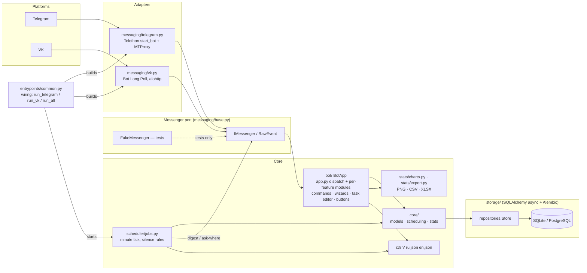

# taskshed — task reminder bot with location awareness

**Language:** [English](README.md) · [Русский](README.ru.md)

A chat bot that reminds you of your tasks **depending on where you are right
now**: home routines at home, work tasks at work. Works on **Telegram**
(Telethon, MTProto proxy support) and **VK** (Bot Long Poll) through a single
platform-independent core.

> The bot never tracks your GPS location — you tell it where you are with one
> tap ("Home" / "Work" / ...). Reminders are silent when nothing is due.

## Features

- Tasks split by **places** you define yourself (`/places`) — or typed straight
  into the task wizard, which creates them. Place management is one live screen:
  typed names add, 🗑 asks right in the message (deleting a place takes its
  tasks and history), ✔️ Готово leaves.
- Four schedule kinds — **one-off**, **every N days**, **by weekdays**, **every
  M of the month** — and all four answer the same two questions: the **deadline**
  (a moment for a one-off, a clock on each repeat day for the rest) and **how
  long before it to warn you** (5 minutes…a week). Deadlines are kept on *your*
  clock: the bot stores them as wall-clock in your time zone and re-derives the
  whole open future the moment you change it. A one-off can also open a work
  window («from … to …») and be moved to ▶ in progress — started work is never
  counted as missed. Every repeat is a materialized **occurrence** you can mark
  ✅ done, 💤 notify later (15 min/1 h/4 h/1 day), ⏭ skip or ▶ in progress right
  inside its own message.
- **One message per task**: a notice is the header, then one message per task of
  your current place with its own buttons, then the other places as one brief
  line-up, and a single ✅ Готово that ends the round and brings the menu back.
  Tapping a button re-draws that very message instead of adding another one.
- **Two moments of their own**: a **morning digest** at a time you set (everything
  due today, everything whose warning opened today, and everything whose warning
  already passed while the deadline is still ahead), and a **repeat every T
  minutes** for tasks sitting between their warning moment and their deadline.
- **One ⚙️ settings screen** per user: reminders on/off, the morning moment, the
  repeat interval, quiet hours, time zone, how long your chosen location stays
  valid, how far ahead charts are drawn, language and the **platform linking
  status** (Telegram/VK).
- **One way to say a time**: `13.00`, `13`, `завтра 9`, `15.11 14.30` parse the
  same way in every question, the bot repeats what it understood («Понял так:
  27.10.2026 13:00. Верно?») before saving, and every question also has buttons.
- **Task editor** (`/edit`): change the title, place, repeat rule, deadline or
  the warning lead of any task, or delete it — upcoming, recurring and past
  tasks are one tab away. Editing a schedule rebuilds the open repeats and keeps
  the finished history.
- Only the newest screen stays clickable: keyboards of older messages are
  stripped automatically.
- **No noise**: if there is nothing to announce today — no open repeat whose
  deadline is ahead and whose warning moment has come — the bot says nothing.
  A notice is built for the place you are at: its tasks in full, the others in
  brief. Stale location → it just asks "Where are you now?", and that question
  is modal: a dialog you were in the middle of (task wizard, report) waits
  behind it and is replayed afterwards — or you tap ⏭ Not now.
- **Statistics**: text summary, CSV/XLSX export, PNG charts — **everything
  split by place**, one copy of every report per place. A GitHub-style activity
  heatmap (missed / planned / skipped markers, drawn forward to the horizon
  from your settings — a week by default, always in whole weeks — and back only
  as far as real tasks go) plus an **hour-level map for short periods** that
  marks missed and still-planned work and outlines the hour you are standing
  in; its rows are the weekdays of the sliding week — three days back, today,
  three ahead — and **⬅️/➡️ buttons page it week by week**, so next week's plan
  is one tap away. Both maps name their axes, and the caption under each
  picture explains the colors.
- **Multi-account**: link your Telegram and VK identities with a one-time
  code (`/link`); data and reminders are shared.
- Chat interfaces in **Russian and English** (`/lang`).
- Persistent storage: SQLite by default, PostgreSQL-ready (SQLAlchemy 2,
  Alembic migrations).

## Quick start

```bash
python -m venv .venv && source .venv/bin/activate
pip install -e ".[dev]"

cp config.example.yaml config.yaml   # fill in tokens & (optional) proxy
alembic upgrade head                 # create the database schema

python -m taskshed.entrypoints.run_telegram   # Telegram only
python -m taskshed.entrypoints.run_vk         # VK only
python -m taskshed.entrypoints.run_all        # both platforms at once
```

Environment variables (all prefixed `TASKSHED_`, e.g. `TASKSHED_TELEGRAM_BOT_TOKEN`)
override the matching `config.yaml` keys.

### Telegram MTProto proxy

```yaml
platforms:
  telegram:
    proxy: {type: mtproxy, ip: "1.2.3.4", port: 443, secret: "..."}
```

VK API uses ordinary HTTPS, so VK takes a regular HTTP/SOCKS5 proxy URL.

## Chat commands

| Command | Meaning |
|---|---|
| `/start` | register |
| `/where` (RU: `/гдея`) | set current place |
| `/tasks` (`/задачи`) | tasks for the current place |
| `/task` (`/задача`) | create a task (guided dialog) |
| `/edit` (`/изменить`) | change any field of a task, or delete it |
| `/places` (`/места`) | manage places |
| `/settings` (`/настройки`; `/reminders` alias) | all user settings |
| `/stats` (`/статистика`) `[week\|month\|year\|all] [csv\|xlsx\|chart]` | reports |
| `/link` / `/unlink` (`/привязать` / `/отвязать`) | link Telegram ↔ VK |
| `/lang` | switch language (ru/en) |

## Development

```bash
ruff check . && pytest      # lint + tests (all chat tests use FakeMessenger — no network)
python scripts/smoke_chat.py  # offline end-to-end chat walk through the real BotApp
```

- Plan & roadmap: [`docs/PLAN.md`](docs/PLAN.md)
- Architecture (EN/RU): [`docs/en/architecture.md`](docs/en/architecture.md) ·
  [`docs/ru/architecture.md`](docs/ru/architecture.md)
- Configuration: [`docs/en/configuration.md`](docs/en/configuration.md) ·
  [`docs/ru/configuration.md`](docs/ru/configuration.md)
- Account linking: [`docs/en/linking.md`](docs/en/linking.md) ·
  [`docs/ru/linking.md`](docs/ru/linking.md)
- Diagrams: [`docs/diagrams/`](docs/diagrams/) (Mermaid sources + rendered PNGs;
  the blocks below render as vector graphics on GitHub)

- Changelog: [`CHANGELOG.md`](CHANGELOG.md)

<!-- mermaid:begin architecture -->

<!-- mermaid:end architecture -->

PNG version: [architecture.png](docs/diagrams/architecture.png)

## License

MIT
