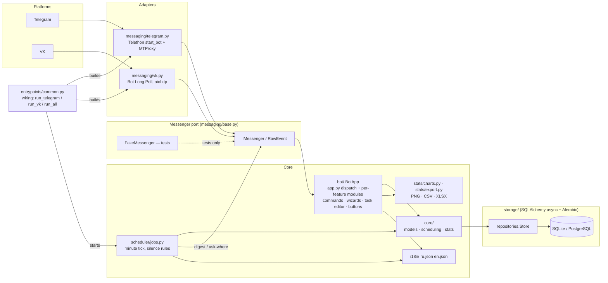

# taskshed — бот напоминаний о задачах с привязкой к местам

**Язык:** [English](README.md) · [Русский](README.ru.md)

Чат-бот, который напоминает о задачах **в зависимости от того, где вы
находитесь**: домашняя рутина — дома, рабочие задачи — на работе. Работает в
**Telegram** (Telethon, поддержка MTProto-прокси) и **VK** (Bot Long Poll)
через единое платформо-независимое ядро.

> Бот не следит за вашей геолокацией — вы сами сообщаете ему, где находитесь,
> одним нажатием («Дома» / «На работе» / …). Если напоминать не о чем — бот
> молчит.

## Возможности

- Задачи разделены по **местам**, которые создаёте вы сами (`/места`) — или просто
  набираете название прямо в анкете задачи, и место создаётся. Управление местами
  — одно живое сообщение: набор текстом добавляет, 🗑 спрашивает прямо в нём
  (с местом уходят его задачи и история), «✔️ Готово» — выход.
- Четыре вида расписания — **разовая**, **раз в N дней**, **по дням недели**,
  **каждое M число** — и у всех одни и те же два вопроса: **дедлайн** (момент у
  разовой, часы у повторов) и **за сколько до него предупредить** (от 5 минут до
  недели). Дедлайны живут **по вашим часам**: бот хранит их местным временем в
  вашем часовом поясе и пересчитывает всё открытое будущее, стоит сменить пояс.
  У разовой задачи может быть окно работы («с … до …») и статус ▶ «В работе» —
  начатое просрочкой не считается. Каждый повтор — материализованное
  **срабатывание**, которое можно отметить ✅ «Готово», 💤 «Уведомить позже»
  (15 мин/час/4 часа/сутки), ⏭ пропустить или ▶ «В работе» прямо в его сообщении.
- **Одна задача — одно сообщение**: уведомление — это заголовок, затем по
  сообщению на каждую задачу текущего места с её кнопками, затем кратко задачи
  остальных мест и всегда футер: ✅ «Готово» завершает раунд и возвращает
  главное меню, 🌍 «Все задачи» показывает открытые задачи **всех** мест одним
  экраном. Нажатие кнопки перерисовывает то же сообщение, а не добавляет новое.
- **Из любого перехода есть выход**: на последнем уровне любого перехода по
  меню — ✅ «Готово» с возвратом в главное меню (⬅️ Назад поднимает только на
  шаг внутри диалога), а почасовая карта листается по неделям **без предела** —
  на кнопке листания подписаны даты недели, куда она ведёт.
- **Два момента, у которых свои правила**: **утренняя сводка** в заданное вами
  время (всё, у чего дедлайн сегодня; всё, у чего уведомление открывается
  сегодня; всё, у чего уведомление уже было, а дедлайн впереди) и **повтор
  каждые T минут**, пока задача сидит между уведомлением и дедлайном.
- **⚙️ Один экран настроек** для пользователя: напоминания вкл/выкл, время
  утренней сводки, интервал повтора, тихие часы, часовой пояс, срок актуальности
  места, на сколько дней вперёд строятся графики, язык и **статус привязки платформ** (Telegram/VK).
- **Один способ назвать время**: `13.00`, `13`, `завтра 9`, `15.11 14.30`
  понимаются одинаково в любом вопросе, бот переспрашивает — «Понял так:
  27.10.2026 13:00. Верно?» — и только потом сохраняет; у каждого вопроса есть и
  кнопки с готовыми вариантами.
- **Редактор задач** (`/изменить`): поменять название, место, правило повтора,
  срок или «за сколько предупредить» — и удалить задачу; вкладки «будущие /
  периодические / прошлые». Смена расписания перестраивает открытые повторы,
  история выполненного остаётся.
- В чате остаётся кликабельным только последний экран: кнопки у старых
  сообщений снимаются.
- **Без шума**: нечего сообщать — бот молчит. Уведомление строится по текущему
  месту: его задачи подробно, остальные кратко. Место «протухло» — бот лишь
  спрашивает «Где вы сейчас?», и этот вопрос модальный: если вы были в середине
  диалога (анкета задачи, отчёт), он ждёт за ним и возвращается после ответа —
  либо жмёте ⏭ «Не сейчас».
- **Статистика**: текстовая сводка, выгрузка CSV/XLSX, PNG-графика — **всё
  раздельно по местам**, по одному экземпляру каждого отчёта на каждое место.
  Тепловая карта активности в стиле GitHub (метки просроченных/запланированных/
  пропущенных, окно графика вытянуто вперёд на выбранный горизонт — по
  умолчанию неделя, всегда целыми неделями, — а назад только до реальных задач)
  и **почасовая карта для коротких периодов**, где тоже видно просроченное и
  ещё не сделанное, обведён текущий час; строки там — дни недели скользящей
  недели (три дня назад, сегодня, три вперёд), а **⬅️/➡️ листают её по неделям
  без предела** — на кнопке подписаны даты недели, куда она ведёт. На обоих
  графиках подписаны оси, а цвета объясняются подписью под картинкой.
- **Мультиаккаунт**: привяжите Telegram и VK одноразовым кодом (`/link`) —
  данные и напоминания общие.
- Интерфейс на **русском и английском** (`/lang`).
- Постоянное хранилище: по умолчанию SQLite, готово к PostgreSQL
  (SQLAlchemy 2, миграции Alembic).

## Быстрый старт

```bash
python -m venv .venv && source .venv/bin/activate
pip install -e ".[dev]"

cp config.example.yaml config.yaml   # впишите токены и (опционально) прокси
alembic upgrade head                 # создать схему БД

python -m taskshed.entrypoints.run_telegram   # только Telegram
python -m taskshed.entrypoints.run_vk         # только VK
python -m taskshed.entrypoints.run_all        # обе платформы сразу
```

Переменные окружения с префиксом `TASKSHED_` (например `TASKSHED_TELEGRAM_BOT_TOKEN`)
перекрывают соответствующие ключи `config.yaml`.

### MTProto-прокси для Telegram

```yaml
platforms:
  telegram:
    proxy: {type: mtproxy, ip: "1.2.3.4", port: 443, secret: "..."}
```

VK API работает по обычному HTTPS, поэтому для VK указывается стандартный
HTTP/SOCKS5-прокси.

## Команды чата

| Команда | Значение |
|---|---|
| `/start` | регистрация |
| `/гдея` | выбрать текущее место |
| `/задачи` | задачи текущего места |
| `/задача` | создать задачу (диалог-анкета) |
| `/изменить` | изменить любой пункт задачи или удалить её |
| `/места` | управление местами |
| `/настройки` (ранее `/напоминания`) | все настройки пользователя |
| `/статистика` `[неделя\|месяц\|год\|всё] [csv\|xlsx\|график]` | отчёты |
| `/привязать` / `/отвязать` | связать Telegram ↔ VK |
| `/lang` | сменить язык (ru/en) |

## Разработка

```bash
ruff check . && pytest      # линт + тесты (чат-тесты идут через FakeMessenger, без сети)
python scripts/smoke_chat.py  # офлайн-прогон всего чат-флоу через боевой BotApp
```

- План и дорожная карта: [`docs/PLAN.md`](docs/PLAN.md)
- Архитектура (EN/RU): [`docs/en/architecture.md`](docs/en/architecture.md) ·
  [`docs/ru/architecture.md`](docs/ru/architecture.md)
- Конфигурация: [`docs/en/configuration.md`](docs/en/configuration.md) ·
  [`docs/ru/configuration.md`](docs/ru/configuration.md)
- Привязка аккаунтов: [`docs/en/linking.md`](docs/en/linking.md) ·
  [`docs/ru/linking.md`](docs/ru/linking.md)
- Диаграммы: [`docs/diagrams/`](docs/diagrams/) (исходники Mermaid + готовые PNG;
  блоки ниже GitHub отображает в векторе)

- История изменений: [`CHANGELOG.md`](CHANGELOG.md)

<!-- mermaid:begin architecture -->

<!-- mermaid:end architecture -->

PNG-версия: [architecture.png](docs/diagrams/architecture.png)

## Лицензия

MIT
