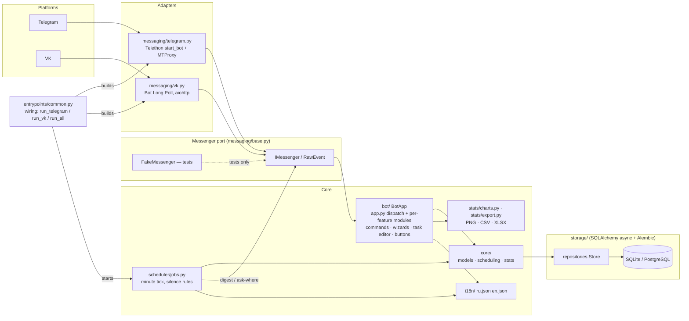
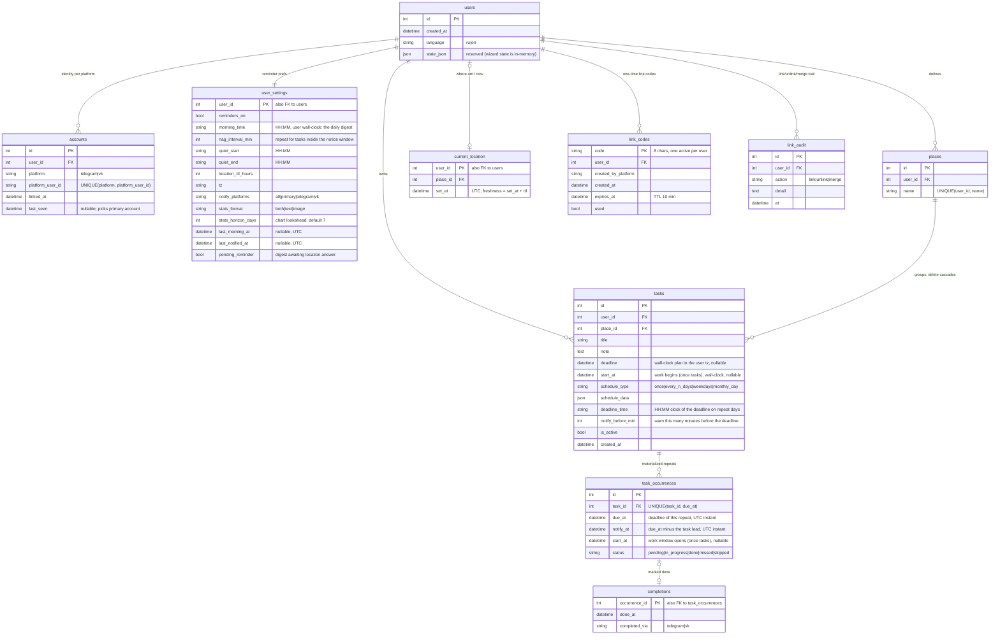
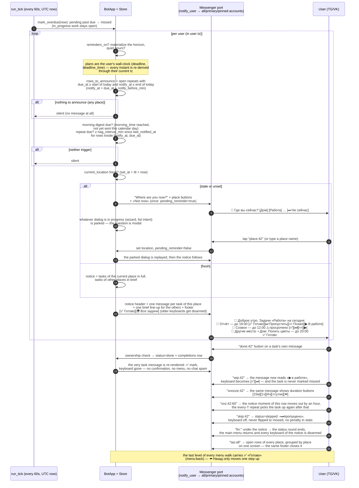
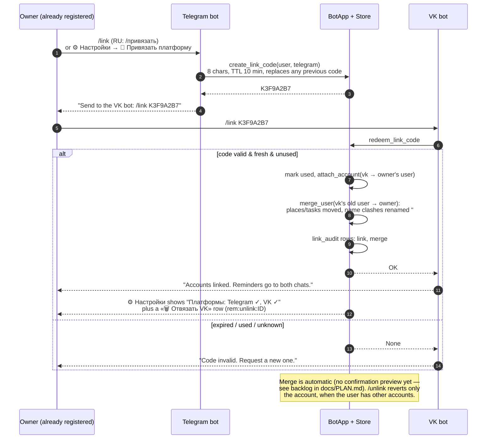

# Architecture (English)

## Diagrams

The blocks below are rendered by GitHub itself (vector). Their text is synced
from the `.mmd` sources in [`docs/diagrams/`](../diagrams/) — those remain the
single source of truth; run `scripts/sync_diagram_blocks.py` after editing one
(`tests/test_docs_diagrams.py` keeps the copies honest).

<!-- mermaid:begin architecture -->

<!-- mermaid:end architecture -->

<!-- mermaid:begin er-diagram -->

<!-- mermaid:end er-diagram -->

For offline or non-GitHub readers there are PNGs, regenerated with
`scripts/render_diagrams.sh`: [architecture.png](../diagrams/architecture.png) ·
[er-diagram.png](../diagrams/er-diagram.png) ·
[reminder-flow.png](../diagrams/reminder-flow.png) ·
[linking-flow.png](../diagrams/linking-flow.png)

## Idea

Hexagonal (ports & adapters). `taskshed/core` contains pure domain logic and
knows nothing about Telegram or VK. Each platform is an adapter that
(1) translates raw platform events into a platform-independent `RawEvent`
(messages and button presses), and (2) implements the `IMessenger` port
(`send_text`, `send_buttons`, `send_image`, `send_document`). Chat logic
(`BotApp` — dispatch in `bot/app.py`, one dialog per module under `bot/`)
and the reminder scheduler (`scheduler/jobs.py`) work only with
`RawEvent` / `IMessenger`.

Consequences that matter for tests: the whole bot can run in unit tests
against `messaging/base.py::FakeMessenger` and an in-memory SQLite database —
no network, no real platforms.

## Module map

| Module | Responsibility |
|---|---|
| `taskshed/core/models.py` | domain dataclasses (`Task`, `Place`, `TaskOccurrence`, …) |
| `taskshed/core/scheduling.py` | schedule rules → occurrence datetimes; materialization; overdue pass |
| `taskshed/core/stats.py` | period aggregations (day/task/place) |
| `taskshed/storage/` | SQLAlchemy async ORM tables + repositories, Alembic migrations |
| `taskshed/messaging/` | port + `FakeMessenger` (`base.py`) + `telegram.py`, `vk.py` |
| `taskshed/bot/` | `BotApp` (`app.py`) + one module per dialog: wizard, editor, cards, digest, reports, settings, location, places; shared state in `base.py` |
| `taskshed/scheduler/jobs.py` | per-minute reminder tick, silence rules |
| `taskshed/stats/` | matplotlib charts (daily + hourly activity maps), CSV/XLSX export |
| `taskshed/i18n/` | ru/en JSON catalogs + `t()` |
| `taskshed/config.py` | YAML + env config (per-platform proxy blocks) |
| `taskshed/entrypoints/` | `run_telegram`, `run_vk`, `run_all` |

## Domain model

See the [ER diagram](../diagrams/er-diagram.mmd). Key point: **`users` are
platform-agnostic**; `accounts` map `(platform, platform_user_id)` onto a
`user`. Everything else (tasks, places, settings) hangs off `users.id`, which
is what makes Telegram↔VK linking trivial.

### Schedules and occurrences

`schedule_type`: `once` · `every_n_days` · `weekdays` · `monthly_day`,
parameters in `schedule_data` (JSON). Every kind answers the same two
questions: **when it has to be ready** and **how long before that to warn** —
`deadline_time` (the clock the deadline falls at on each repeat day) plus
`notify_before_min`; a one-off instead stores its own ready-by moment in
`tasks.deadline`.

**Plans are kept in the user's own time.** `tasks.deadline`, `tasks.start_at`,
`tasks.deadline_time` and the settings clocks are wall-clock values on the
owner's calendar, never host time. `task_occurrences` are real UTC instants
derived from those plans: `due_at` is the deadline,
`notify_at = due_at − notify_before_min`. Switching a user's `tz` re-derives
their whole open future (`Store.replan_open_occurrences`) — «к 18:00» still
means 18:00 on *their* watch — while finished history is left untouched.

Occurrences are materialized a few days ahead
(`bot.occurrence_horizon_days`); each has `start_at` and
`status ∈ {pending, in_progress, done, missed, skipped}`. A background pass
flips `pending` rows whose deadline passed to `missed`; a user-skipped
occurrence becomes `skipped` — it is hidden from today's list, never turns
into `missed` and does not count against the completion percent. A one-off task
is not a single instant either: `tasks.start_at` opens a work window and
`tasks.deadline` is the ready-by moment, so the row shows «from … to …» and
appears in the list from its start day on. Tapping **▶ В работе** sets
`in_progress`: the deadline stays, the row is never punished as missed, and it
remains visible until done or skipped.

### Reminder tick

<!-- mermaid:begin reminder-flow -->

<!-- mermaid:end reminder-flow -->

Hard rules:
1. quiet hours / `reminders_on=false` → nothing;
2. nothing to announce today — no open repeat with `due_at` ≥ start of the
   day and `notify_at` ≤ end of the day → nothing;
3. no trigger yet → nothing. There are two: the **morning digest** at
   `morning_time` (once per calendar day, wall-clock in the user's zone) and
   the **every-`nag_interval_min` repeat** over rows sitting inside
   `[notify_at, due_at)`;
4. location older than `location_ttl_hours` → ask «where are you?» with place
   buttons first (the question is modal: an open dialog is parked and
   replayed afterwards);
5. a notice then sends the tasks of the **current place** as one message each
   with buttons, the tasks of **other places** as one brief line-up, and closes
   with a footer that is always sent: ✅ «Готово» (`fin:`) ends the status
   round and returns the main menu, 🌍 «Все задачи» (`tas:all`) shows the open
   rows of **every** place grouped by place on one screen.
6. the last level of any menu walk carries ✅ «Готово» (`menu:back` → main
   menu); ⬅️ Назад only moves one step up inside a dialog. The hour map pages
   by whole weeks in both directions without a limit — each paging button
   carries the shift of the week it draws and names its dates.

### Account linking

<!-- mermaid:begin linking-flow -->

<!-- mermaid:end linking-flow -->

`/link` mints a
one-time 8-char code (10 min TTL, one active per user); the other platform
redeems it. The redeeming account moves to the code owner and its previous
user is merged in automatically (name clashes renamed `#2`); every step is
audited in `link_audit`. A confirmation preview before merge is on the backlog.

## Configuration

`config.yaml` (see `config.example.yaml`), overridable by `TASKSHED_*` env
vars. Telegram supports MTProto proxies (`mtproxy`/`securedmtproxy` —
Telethon's randomized-intermediate connection); VK takes plain http/socks5
since its API is ordinary HTTPS.
