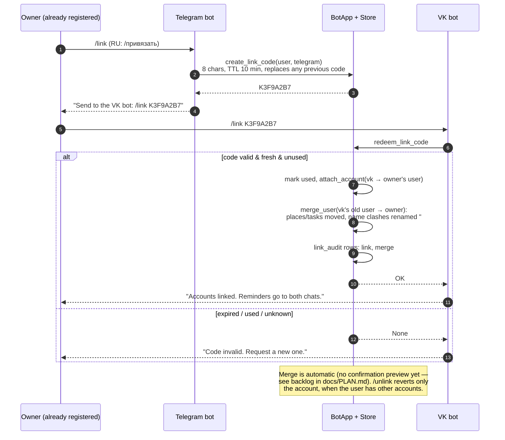

# Account linking (English)

<!-- mermaid:begin linking-flow -->

<!-- mermaid:end linking-flow -->

Source: [linking-flow.mmd](../diagrams/linking-flow.mmd) ·
PNG: [linking-flow.png](../diagrams/linking-flow.png)

One human (`users` row) can own a Telegram and a VK account; tasks, places
and settings live on the user, so they are shared automatically.

- `/link` (RU `/привязать`) mints a one-time 8-character code, valid 10
  minutes, one per user at a time (new code replaces the old one).
- Send `link CODE` to the bot **on the other platform**.
- The other platform's account is moved to the code owner; if that account
  already had its own tasks/places, they are merged into the owner
  (place-name clashes get a `#2` suffix). Every operation lands in
  `link_audit`.
- `/unlink` (RU `/отвязать`) detaches the current account (it becomes a
  fresh empty user on the next message). Refused when it is the only
  account.

Reminder fan-out follows `user_settings.notify_platforms`:
`all` (default) sends to every linked chat; `primary` sends only to the
account with the most recent activity (`accounts.last_seen`).
