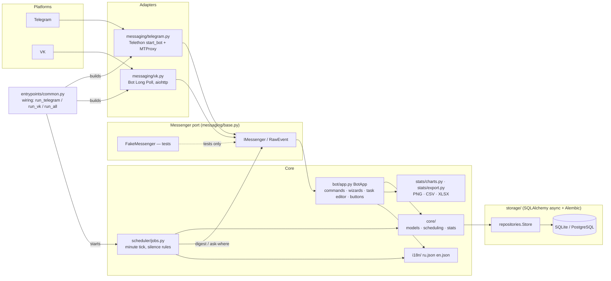
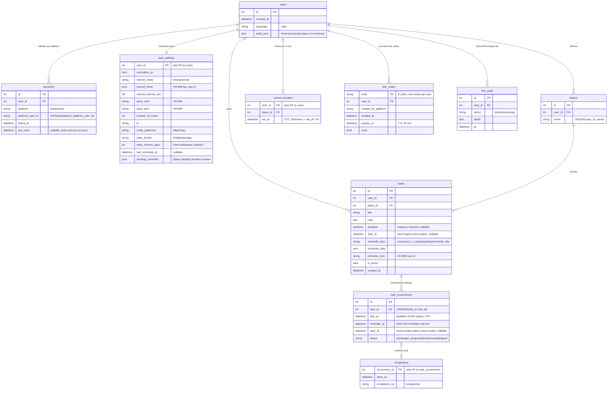
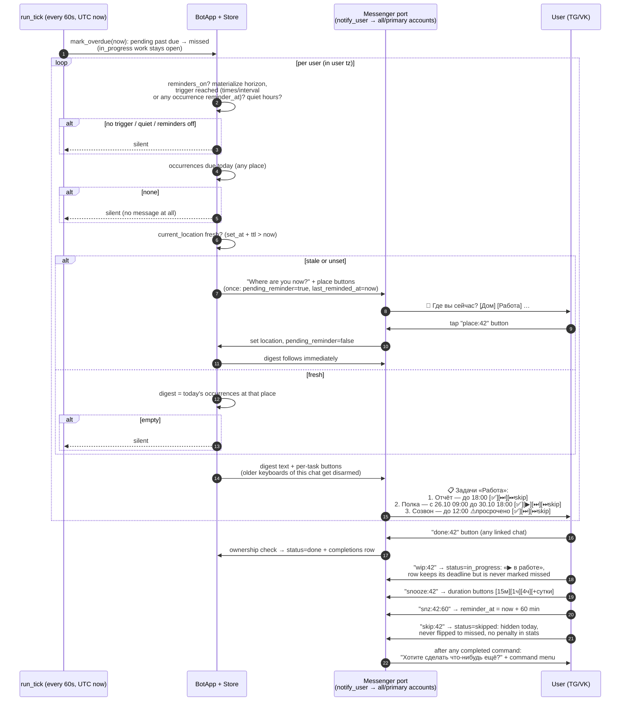
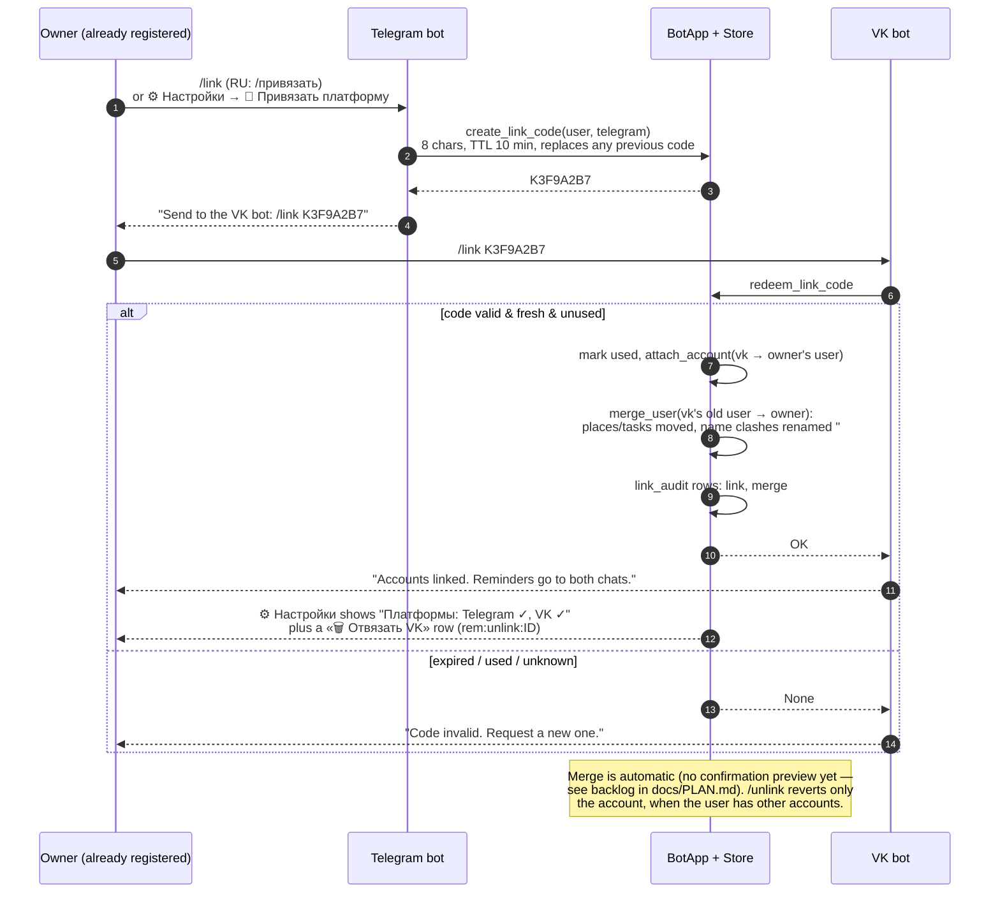

# Архитектура (русский)

## Диаграммы

Ниже блоки отображаются самим GitHub (вектор). Их текст синхронизируется из
исходников `.mmd` в [`docs/diagrams/`](../diagrams/) — они остаются единственным
источником истины; после правки `.mmd` запускайте `scripts/sync_diagram_blocks.py`
(`tests/test_docs_diagrams.py` следит, чтобы копии не разъезжались).

<!-- mermaid:begin architecture -->

<!-- mermaid:end architecture -->

<!-- mermaid:begin er-diagram -->

<!-- mermaid:end er-diagram -->

Для чтения офлайн и не на GitHub есть PNG (перегенерация —
`scripts/render_diagrams.sh`): [architecture.png](../diagrams/architecture.png) ·
[er-diagram.png](../diagrams/er-diagram.png) ·
[reminder-flow.png](../diagrams/reminder-flow.png) ·
[linking-flow.png](../diagrams/linking-flow.png)

## Идея

Гексагональная архитектура (порты и адаптеры). `taskshed/core` — чистая
доменная логика, которая ничего не знает про Telegram и VK. Каждая платформа —
адаптер, который (1) переводит сырые события платформы в платформо-независимый
`RawEvent` (текст сообщений и нажатия кнопок) и (2) реализует порт `IMessenger`
(`send_text`, `send_buttons`, `send_image`, `send_document`). Логика чата
(`bot/app.py::BotApp`) и планировщик (`scheduler/jobs.py`) работают только с
`RawEvent` / `IMessenger`.

Практическое следствие для тестов: весь бот прогоняется в юнит-тестах против
`messaging/base.py::FakeMessenger` и in-memory SQLite — без сети и реальных
платформ.

## Модули

| Модуль | Ответственность |
|---|---|
| `taskshed/core/models.py` | доменные датаклассы (`Task`, `Place`, `TaskOccurrence`, …) |
| `taskshed/core/scheduling.py` | правила расписания → даты срабатываний, материализация, просрочки |
| `taskshed/core/stats.py` | агрегации за период (дни/задачи/места) |
| `taskshed/storage/` | таблицы SQLAlchemy async + репозитории, миграции Alembic |
| `taskshed/messaging/` | порт + `FakeMessenger` (`base.py`) + `telegram.py`, `vk.py` |
| `taskshed/bot/app.py` | `BotApp`: команды чата, диалоги-анкеты, кнопки |
| `taskshed/scheduler/jobs.py` | ежеминутный тик напоминаний, правила молчания |
| `taskshed/stats/` | графики matplotlib (дневные и почасовые карты активности), экспорт CSV/XLSX |
| `taskshed/i18n/` | каталоги ru/en JSON + `t()` |
| `taskshed/config.py` | конфиг YAML + env, прокси по платформам |
| `taskshed/entrypoints/` | `run_telegram`, `run_vk`, `run_all` |

## Модель данных

См. [ER-диаграмму](../diagrams/er-diagram.mmd). Ключевое: **`users` не зависит
от платформы**; `accounts` отображает `(platform, platform_user_id)` на
`user`. Всё остальное (задачи, места, настройки) висит на `users.id` — поэтому
привязка Telegram↔VK тривиальна.

### Расписания и срабатывания

`schedule_type`: `once` · `every_n_days` · `weekdays` · `monthly_day`,
параметры в `schedule_data` (JSON). Срабатывания материализуются на несколько
дней вперёд (`bot.occurrence_horizon_days`); у каждого `due_at`, `reminder_at`,
`start_at`, `status ∈ {pending, in_progress, done, missed, skipped}`. Фоновый
проход переводит `pending` с истёкшим сроком в `missed`; пропущенная
пользователем задача становится `skipped` — она скрывается из списка на
сегодня, никогда не становится `missed` и не портит процент выполнения.
Разовая задача — не миг: `tasks.start_at` открывает окно работы, а
`tasks.deadline` — срок готовности, поэтому строка показывается «с … до …» и
появляется в списке со дня начала. Кнопка **▶ В работе** ставит
`in_progress`: срок остаётся, просрочкой задача не считается и видна в списке,
пока её не сделают или не пропустят.

### Тик напоминаний

<!-- mermaid:begin reminder-flow -->

<!-- mermaid:end reminder-flow -->

Жёсткие правила:
1. тихие часы / `reminders_on=false` / момент срабатывания не наступил → молчим;
2. нет срабатываний на сегодня → молчим;
3. место старше `location_ttl_hours` → сначала вопрос с кнопками мест;
4. нет срабатываний по текущему месту → молчим.

### Привязка аккаунтов

<!-- mermaid:begin linking-flow -->

<!-- mermaid:end linking-flow -->

`/привязать` создаёт
одноразовый 8-символьный код (TTL 10 минут, активен только один за раз);
вторая платформа его активирует. Аккаунт переносится к владельцу кода, его
прежний пользователь сливается автоматически (коллизии имён мест получают
`#2`); все шаги пишутся в `link_audit`. Предпросмотр слияния — в бэклоге.

## Конфигурация

`config.yaml` (образец — `config.example.yaml`), переменные `TASKSHED_*`
переопределяют. Telegram поддерживает MTProto-прокси (`mtproxy` /
`securedmtproxy`, соединение Telethon randomized-intermediate); для VK —
обычные http/socks5, так как API VK это обычный HTTPS.
