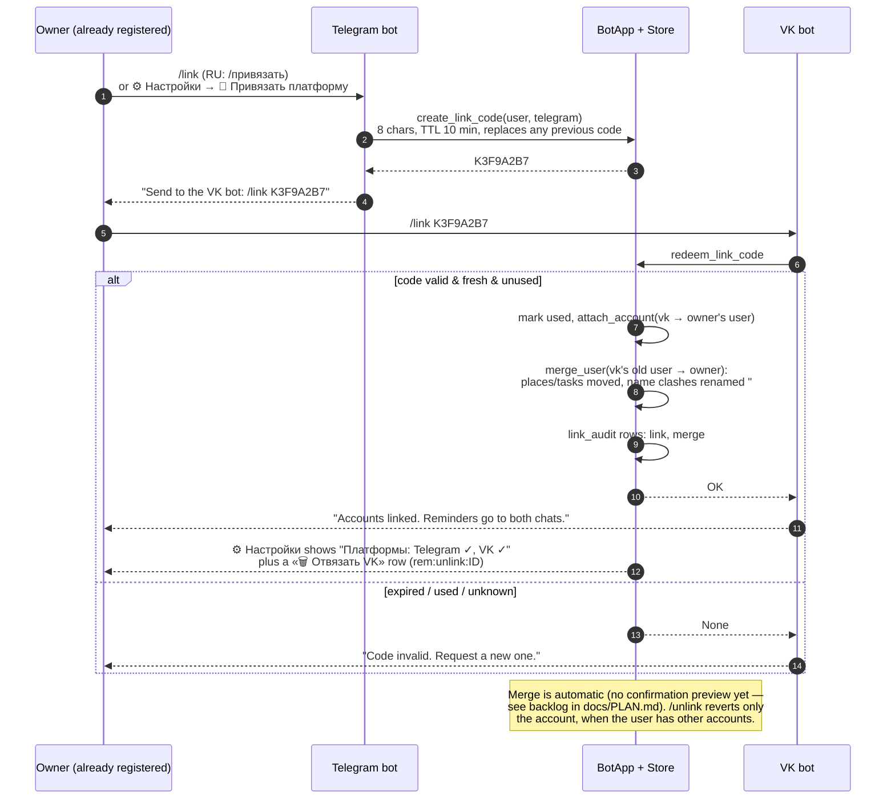

# Привязка аккаунтов (русский)

<!-- mermaid:begin linking-flow -->

<!-- mermaid:end linking-flow -->

Источник: [linking-flow.mmd](../diagrams/linking-flow.mmd) ·
PNG: [linking-flow.png](../diagrams/linking-flow.png)

Один человек (строка `users`) может владеть аккаунтами в Telegram и VK;
задачи, места и настройки привязаны к пользователю и общие по умолчанию.

- `/привязать` создаёт одноразовый 8-символьный код, живущий 10 минут;
  у пользователя одновременно активен только один код (новый заменяет старый).
- `привязать КОД` отправляется боту **на другой платформе**.
- Аккаунт второй платформы переносится к владельцу кода; если у него уже
  были свои задачи/места, они сливаются (одноимённые места получают суффикс
  `#2`). Все действия пишутся в `link_audit`.
- `/отвязать` отвязывает текущий аккаунт (со следующего сообщения он —
  новый пустой пользователь). Запрещено, если аккаунт единственный.

Рассылка напоминаний определяется `user_settings.notify_platforms`
(⚙️ Настройки → 📡 Куда слать): `primary` (по умолчанию) — только в чат,
где вы последний раз общались с ботом (`accounts.last_seen`); `all` — во все
привязанные чаты; `telegram` / `vk` — прикрепить рассылку к одной платформе
(если она не привязана, берётся самый активный аккаунт).
